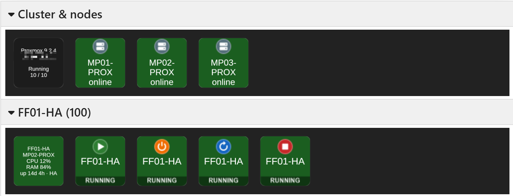

# companion-module-proxmox-ve

Bitfocus Companion module for Proxmox VE: start, shutdown, reboot and stop VMs/containers, with live status. Cluster and HA aware (failover across nodes, guests addressed by VMID).



Per guest: an info tile (node, CPU, RAM, uptime, HA) and start, shutdown, reboot and stop buttons with the status fixed at the bottom and the name scaled to fit. Colors follow the state: green = running, dark = stopped, amber = task running, red = HA problem.

See [companion/HELP.md](companion/HELP.md) for setup and usage.

## Development

```
corepack yarn install
yarn build        # compile to dist/
yarn test         # unit tests
yarn lint
yarn smoke        # read-only test against a real cluster, reads .env (see .env.example)
yarn package      # build the .tgz for Companion
```

Uses the Proxmox VE REST API (`/api2/json`) with API token authentication:

- Status: `GET /cluster/resources` (one request for the whole cluster)
- Power actions: `POST /nodes/{node}/{qemu|lxc}/{vmid}/status/{start|shutdown|reboot|stop}`
- Task tracking: `GET /nodes/{node}/tasks/{upid}/status`

## License

MIT, © meyer.productions
